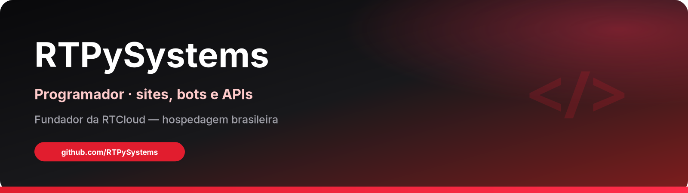
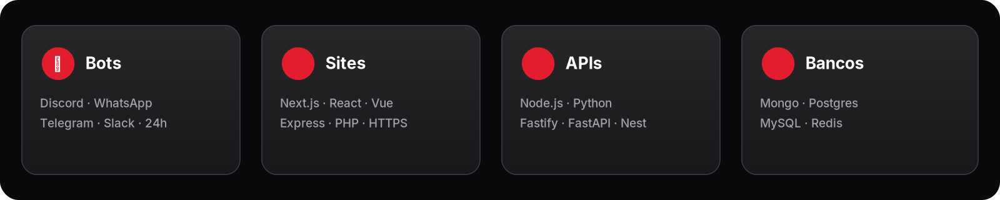

  

  

  <strong>RTPySystems</strong> — programador brasileiro. 
  Faço <em>sites</em>, <em>bots</em>, <em>APIs</em> e automações sob demanda para clientes. 
  Also building <a href="https://rtcloud.com.br">RTCloud</a> — hosting for bots, sites &amp; APIs in Brazil.

  
  
  
  
  

  

## 👨‍💻 Quem eu sou

Sou o **RTPySystems**. Programo no dia a dia: do zero ao ar — landing, painel, bot 24h, API com webhook, Pix e entrega automática.

Minha marca pessoal é **resolver o problema do cliente** com código limpo, deploy estável e suporte que responde. Quando o projeto precisa de hospedagem séria, sobe na **[RTCloud](https://rtcloud.com.br)** — plataforma que eu mesmo construo e mantenho.

> *“Plataforma RTCloud construída e mantida por RTPySystems.”* — rodapé de [rtcloud.com.br](https://rtcloud.com.br)

  

## 🤖 Bases de bots

Três projetos abertos que mantenho para quem quer tirar um bot do papel com código organizado, documentação clara e uma base fácil de adaptar.

<table>
  <tr>
    <td width="33%" valign="top">
      
      <h3>Discord</h3>
      
<strong>Node.js 24 · discord.js v14</strong>

      
Slash commands, permissões, cooldowns, embeds e eventos organizados.

      
<a href="https://github.com/RTPySystems/discord-bot-base"><strong>Ver código e usar a base →</strong></a>

    </td>
    <td width="33%" valign="top">
      
      <h3>Telegram</h3>
      
<strong>Node.js 24 · grammY</strong>

      
Menu inline, comandos, middlewares, acesso administrativo e rate limiting.

      
<a href="https://github.com/RTPySystems/telegram-bot-base"><strong>Ver código e usar a base →</strong></a>

    </td>
    <td width="33%" valign="top">
      
      <h3>WhatsApp</h3>
      
<strong>Node.js 24 · Baileys</strong>

      
QR ou pareamento, sessão persistente, reconexão com backoff e anti-spam.

      
<a href="https://github.com/RTPySystems/whatsapp-bot-base"><strong>Ver código e usar a base →</strong></a>

    </td>
  </tr>
</table>

As três bases têm **licença MIT**, testes, CI, Docker e guia de **[deploy na RTCloud](https://rtcloud.com.br)**. Abra o repositório e use **Use this template** para começar o seu projeto.

WhatsApp: integração não oficial, com Baileys em release candidate. Leia os riscos e os limites da persistência de sessão no README antes de usar.

  

## 🛠️ O que eu entrego

| | |
|:--|:--|
| **🌐 Sites & lojas** | Landing, painéis admin, lojas com Pix e entrega automática por e-mail |
| **🤖 Bots** | Discord, Telegram, WhatsApp (Baileys e afins), automações 24h |
| **🔌 APIs** | Node.js / Python, webhooks, filas, integrações, reconciliação |
| **💸 Pagamentos** | Pix (checkout, webhook, status, e-mail de entrega) |
| **☁️ Operação** | Deploy, monitoramento e hospedagem na RTCloud |

  

<strong>🧰 Stack do dia a dia</strong>

- **Backend:** Node.js, TypeScript, Python, Express / Fastify  
- **Front:** Next.js, React, HTML/CSS  
- **Dados:** MongoDB, PostgreSQL, Redis  
- **Bots:** Discord.js / discord.py, Telegram, WhatsApp  
- **Ops:** Linux, GitHub, SMTP, webhooks, Pix  

  

## ☁️ Destaque — RTCloud

  

Meu maior produto público: **hospedagem brasileira** de bots, sites e APIs — painel em português, Pix Automático, `*.rtsystems.app`, AMD EPYC · NVMe · DDoS.

| | |
|:--|:--|
| Site | [rtcloud.com.br](https://rtcloud.com.br) |
| Org | [github.com/rtcloud-br](https://github.com/rtcloud-br) |
| Docs oficial | [docs.rtcloud.com.br](https://docs.rtcloud.com.br) |
| Docs GitHub | [rtcloud-br.github.io/rtcloud-docs](https://rtcloud-br.github.io/rtcloud-docs/) |
| Novidades | [rtcloud.com.br/novidades](https://rtcloud.com.br/novidades) |
| Status | [status.rtcloud.com.br](https://status.rtcloud.com.br) |
| Planos | a partir de **R$ 16,24/mês** (Spark) |

  

  

## 📊 GitHub

  
  

  

  

## 📬 Contato (fechamento de projeto)

| Canal | Link |
|:--|:--|
| WhatsApp | [(21) 99873-3107](https://wa.me/5521998733107) |
| E-mail | [contato@rtcloud.com.br](mailto:contato@rtcloud.com.br) |
| Discord | [discord.gg/vbNbKxDR7](https://discord.gg/vbNbKxDR7) |
| Instagram / TikTok | [@rtcloud.br](https://www.instagram.com/rtcloud.br/) |
| Site / produto | [rtcloud.com.br](https://rtcloud.com.br) |

---

  Feito por <strong>RTPySystems</strong> · © RTCloud · <a href="https://rtcloud.com.br/privacidade">Privacidade</a> · <a href="https://rtcloud.com.br/termos">Termos</a>

