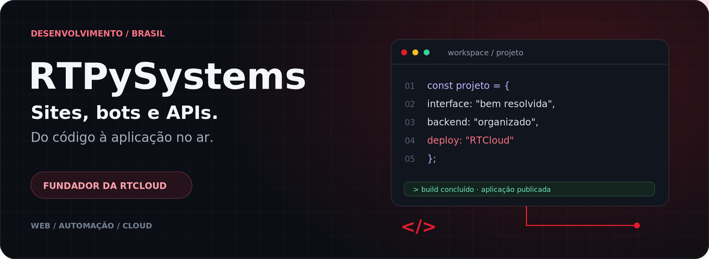
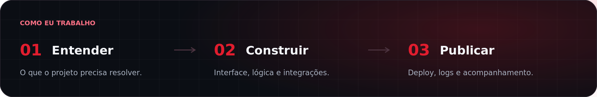
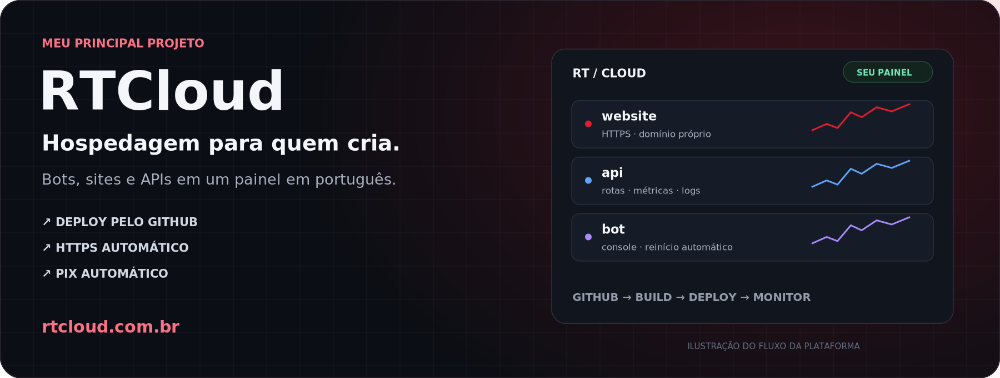
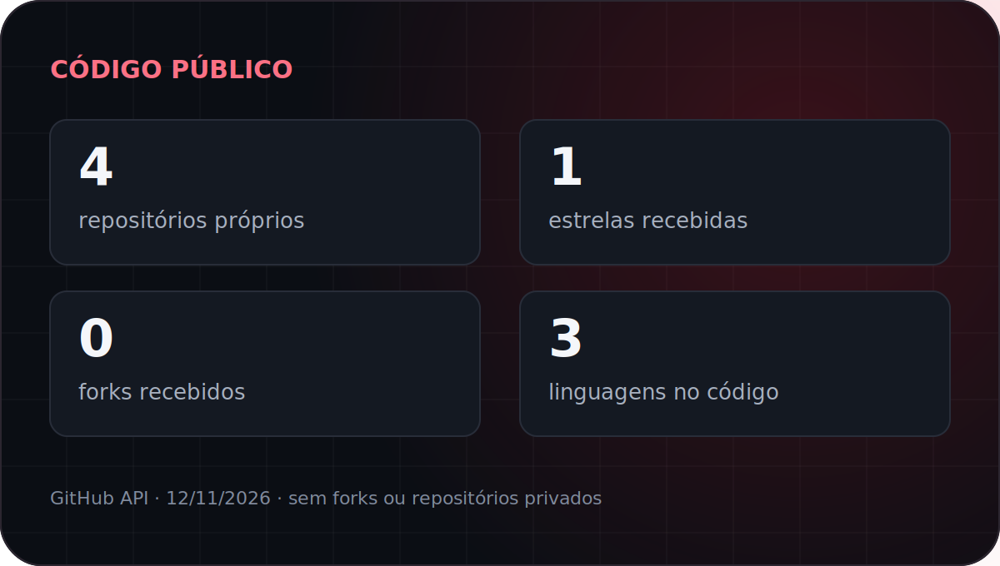
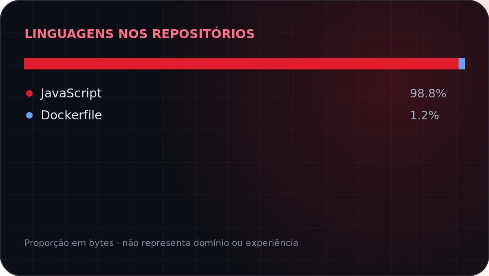

  

  <a href="#sobre">Sobre</a> · <a href="#rtcloud">RTCloud</a> · <a href="#projetos">Projetos</a> · <a href="#stack">Stack</a> · <a href="#contato">Contato</a>

## Código, produto e o que vem depois do deploy.

Sou o **RTPySystems**, programador brasileiro e fundador da **[RTCloud](https://rtcloud.com.br)**. Desenvolvo sites, bots, APIs e automações para clientes — da interface às integrações que fazem tudo funcionar.

Trabalho com JavaScript, TypeScript, Python e PHP, escolhendo a tecnologia pelo que o projeto precisa. Gosto de interface bem cuidada, código que dá para manter e aplicação que não depende do meu computador ligado.

Na RTCloud, esse trabalho se encontra: desenvolvimento web, automação e hospedagem no mesmo produto. É onde concentro boa parte do que construo e mantenho.

**[Conheça a RTCloud ↗](https://rtcloud.com.br)** &nbsp; **[Vamos conversar sobre seu projeto ↗](https://wa.me/5521998733107)**

### O que eu desenvolvo

| Área | Na prática |
|:--|:--|
| **Sites e sistemas web** | Landing pages, sites institucionais, painéis e áreas de cliente. |
| **Lojas e pagamentos** | Checkout com Pix, confirmação por webhook e entrega automática. |
| **Bots e comunidades** | Discord, Telegram e WhatsApp: comandos, atendimento e integrações. |
| **APIs e automações** | Serviços em Node.js e Python, webhooks e rotinas entre sistemas. |
| **Deploy e hospedagem** | Publicação, variáveis de ambiente, logs e operação na RTCloud. |

  

## RTCloud · minha empresa de hospedagem

A **RTCloud** é a plataforma que construo e mantenho para colocar projetos no ar sem transformar cada deploy em uma configuração de servidor. Hospedagem de **bots, sites e APIs**, com painel e documentação em português.

| Do projeto ao ar | Para acompanhar e crescer |
|:--|:--|
| **Deploy por ZIP ou GitHub**, com publicação automática a cada push. | **Console ao vivo**, métricas e monitoramento de aplicações. |
| **Node.js, Python, PHP e outras linguagens**, com variáveis por aplicação. | **MongoDB, PostgreSQL, MySQL e Redis** gerenciados, conforme o plano. |
| **Subdomínio `rtsystems.app` e HTTPS**; domínio próprio a partir do Carbon. | **Backups, snapshots e equipes** com permissões por função. |
| **Pix Automático**, com renovação e recibo em PDF. | **AMD EPYC, SSD NVMe e proteção DDoS** nos planos pagos. |

**Para começar:** teste de um bot por **24 horas**, com até **512 MB**, sem cartão. Planos pagos a partir do **Spark: R$ 16,24/mês, com 1 GB de RAM**. [Veja os valores e os limites de cada plano no site.](https://rtcloud.com.br/planos)

**[Site ↗](https://rtcloud.com.br)** · **[Organização no GitHub ↗](https://github.com/rtcloud-br)** · **[Documentação ↗](https://rtcloud-br.github.io/rtcloud-docs/)** · **[Status ↗](https://status.rtcloud.com.br)**

### Novidades da plataforma

- **v5.2** — Analytics com filtros, Network com estado do DNS e balanceamento pelo painel.
- **v5.1 / v5.1.1** — Ferramentas MCP com permissões por ação, aba própria e guias de conexão.
- **v5.0** — App da RTCloud no celular e no computador, com status e documentação integrados.

Resumo das versões 5.0 em diante. Recursos e preços conferidos no site em 06/11/2026. [Changelog completo →](https://rtcloud.com.br/novidades)

## Projetos abertos · bases de bots

Três bases que mantenho para começar com estrutura, comandos e documentação no lugar. Cada repositório explica como configurar, testar e publicar na RTCloud.

<table>
<tr>
<td width="33%" valign="top">

<h3>Discord</h3>

<strong>discord.js v14 · Node.js</strong>

Slash commands, permissões, cooldowns, embeds e eventos organizados.

<a href="https://github.com/RTPySystems/discord-bot-base"><strong>Explorar a base →</strong></a>

</td>
<td width="33%" valign="top">

<h3>Telegram</h3>

<strong>grammY · Node.js</strong>

Menus inline, middlewares, comandos, acesso administrativo e rate limiting.

<a href="https://github.com/RTPySystems/telegram-bot-base"><strong>Explorar a base →</strong></a>

</td>
<td width="33%" valign="top">

<h3>WhatsApp</h3>

<strong>Baileys · Node.js</strong>

QR ou pareamento, sessão persistente, reconexão com backoff e anti-spam.

<a href="https://github.com/RTPySystems/whatsapp-bot-base"><strong>Explorar a base →</strong></a>

</td>
</tr>
</table>

**MIT · Testes · CI · Docker · Guia de deploy.** Use **Use this template** no repositório para começar o seu.

A base de WhatsApp usa uma integração não oficial (Baileys em release candidate). Confira os riscos e os limites de sessão no README antes de usar.

## Tecnologias com que trabalho

A stack muda de projeto para projeto. Estas são as ferramentas entre as quais escolho para construir a interface, o backend e a operação.

**Linguagens**

  
  
  
  
  
  
  

**Backend & bots**

  
  
  
  
  
  
  
  

**Frontend**

  
  
  

**Dados**

  
  
  
  

**Infraestrutura**

  
  
  
  
  

## GitHub · código público

  
  

Cards gerados neste repositório pela API do GitHub, com atualização diária. Só contam repositórios públicos próprios, sem forks. A distribuição de linguagens mostra o código publicado aqui, não toda a minha experiência. [Como são gerados →](scripts/README.md)

## Tem um projeto em mente?

Me conta o que precisa construir, o que já existe e quais integrações entram no caminho. A partir daí, a gente define o escopo.

| Canal | Onde me encontrar |
|:--|:--|
| **WhatsApp** | [(21) 99873-3107](https://wa.me/5521998733107) |
| **E-mail** | [contato@rtcloud.com.br](mailto:contato@rtcloud.com.br) |
| **Discord** | [Comunidade RTCloud](https://discord.gg/vbNbKxDR7) |
| **Instagram / TikTok** | [@rtcloud.br no Instagram](https://www.instagram.com/rtcloud.br/) · [TikTok](https://www.tiktok.com/@rtcloud.br) |
| **Hospedagem** | [rtcloud.com.br](https://rtcloud.com.br) |

---

<strong>RTPySystems</strong> · Desenvolvimento &amp; RTCloud · Brasil

