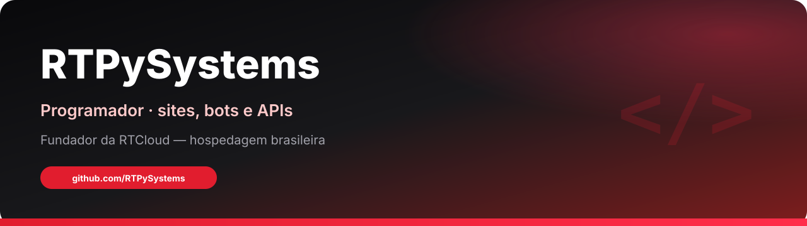
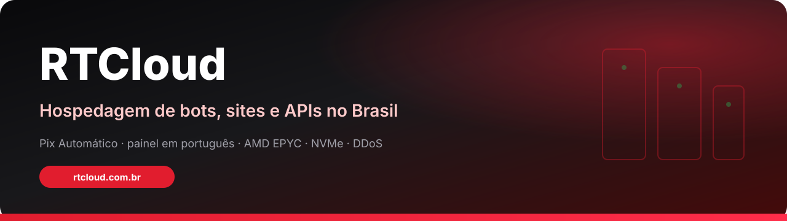
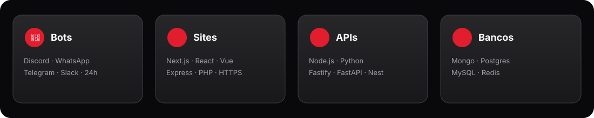

  

  

  <strong>Programador</strong> · projetos para clientes · fundador da <strong><a href="https://rtcloud.com.br">RTCloud</a></strong> 
  <em>Brazilian developer — sites, bots, APIs &amp; RTCloud hosting.</em>

  
  
  
  
  
  
  
  

  

## 👋 Sobre

Sou o **RTPySystems** — programador brasileiro. Faço projetos sob demanda para clientes: **sites**, **bots** (Discord, Telegram, WhatsApp), **APIs**, integrações de **Pix** e automações.

Também construo e mantenho a **[RTCloud](https://rtcloud.com.br)** — hospedagem de bots, sites e APIs no Brasil, com painel em português, Pix Automático e infraestrutura AMD EPYC · NVMe.

> *“Plataforma RTCloud construída e mantida por RTPySystems.”* — rodapé do site oficial.

  

## ☁️ Destaque — RTCloud

  

**Hospedagem de bots, sites e APIs com potência e simplicidade.**

Deploy em minutos · painel em português · Pix Automático · subdomínios `*.rtsystems.app` · HTTPS · ReactorAI · MCP (Claude / ChatGPT / Cursor).

| | |
|:--|:--|
| **Site** | [rtcloud.com.br](https://rtcloud.com.br) |
| **Organização** | [github.com/rtcloud-br](https://github.com/rtcloud-br) |
| **Docs oficial** | [docs.rtcloud.com.br](https://docs.rtcloud.com.br) |
| **Docs GitHub** | [rtcloud-br.github.io/rtcloud-docs](https://rtcloud-br.github.io/rtcloud-docs/) |
| **Planos** | [rtcloud.com.br/planos](https://rtcloud.com.br/planos) — a partir de **R$ 16,24/mês** (Spark) |
| **Status** | [status.rtcloud.com.br](https://status.rtcloud.com.br) |
| **Hardware** | AMD EPYC · SSD NVMe · proteção DDoS |
| **Pagamento** | Pix Automático · recibo em PDF |

  

<strong>📋 Planos (resumo oficial)</strong>

| Plano | RAM | Preço/mês |
|:--|:--|:--|
| Teste (grátis, 24h) | 512 MB | — |
| Spark | 1 GB | R$ 16,24 |
| Steel | 2 GB | R$ 32,49 |
| Carbon (mais vendido) | 4 GB | R$ 58,49 |
| … até Apex | 32 GB | R$ 389,87 |
| Obsidian (empresarial) | 48–768 GB | a partir de R$ 584,87 |

Valores oficiais: [rtcloud.com.br/planos](https://rtcloud.com.br/planos).

  

## 🛠️ O que eu faço para clientes

| Área | Entrego |
|:--|:--|
| **Sites e lojas** | Landing pages, painéis, lojas com Pix e entrega automática |
| **Bots** | Discord, Telegram, WhatsApp (Baileys e afins), automações 24h |
| **APIs** | Node.js / Python, webhooks, filas, integrações |
| **Pagamentos** | Pix (checkout, webhook, reconciliação, e-mail de entrega) |
| **Hospedagem** | Deploy e operação na própria RTCloud |

  

## 🧰 Stack

  

  
  
  
  
  
  
  

  

## 📊 GitHub

  
  

  

  

## 📬 Contato

| Canal | Link |
|:--|:--|
| **RTCloud** | [rtcloud.com.br](https://rtcloud.com.br) |
| **Org GitHub** | [github.com/rtcloud-br](https://github.com/rtcloud-br) |
| **WhatsApp** | [(21) 99873-3107](https://wa.me/5521998733107) |
| **E-mail** | [contato@rtcloud.com.br](mailto:contato@rtcloud.com.br) |
| **Discord** | [discord.gg/vbNbKxDR7](https://discord.gg/vbNbKxDR7) |
| **Instagram / TikTok** | [@rtcloud.br](https://www.instagram.com/rtcloud.br/) |

---

  © RTCloud · desenvolvido por <strong>RTPySystems</strong> · <a href="https://rtcloud.com.br/privacidade">Privacidade</a> · <a href="https://rtcloud.com.br/termos">Termos</a>

